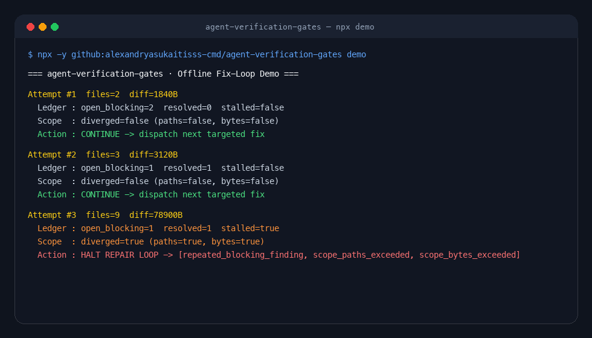

# Agent Verification Gates

[](https://github.com/alexandryasukaitisss-cmd/agent-verification-gates/actions/workflows/ci.yml)
[](https://github.com/alexandryasukaitisss-cmd/agent-verification-gates/releases)
[](package.json)
[](LICENSE)

[Русский](README.ru.md) · [Releases](https://github.com/alexandryasukaitisss-cmd/agent-verification-gates/releases) · [MIT](LICENSE)

**Zero-dependency verification guardrails for AI coding-agent repair loops — deterministic finding ledger, anti-loop stall & oscillation detection, scope growth budgets, read-only git tree integrity hashes, and UI evidence manifest checks.**



Autonomous coding agents fail in predictable ways when left in a `write → test → review → fix` loop: they repeat the same broken fix 5 times, re-introduce a bug they just solved, turn a 2-file patch into a 40-file refactor, mutate the repo inside a "read-only" check, or claim a UI works without real rendered evidence. **Agent Verification Gates** gives your harness or CI four small, provider-neutral Node.js ESM primitives to catch all four deterministically.

## Try it in 5 seconds (zero install)

```sh
npx -y github:alexandryasukaitisss-cmd/agent-verification-gates demo
```

Or install directly in any Node.js 20+ project:

```sh
npm install github:alexandryasukaitisss-cmd/agent-verification-gates
```

## Four Verification Primitives

1. **Deterministic Finding Ledger & Anti-Loop Detector** (`mergeFindingLedger`, `evaluateFixLoopHealth`)
   - Content-hashes findings from gates and reviewers (`kind`, `sourceId`, `severity`, `file`, `line`, `message`) into stable IDs across repair attempts.
   - Tracks `firstSeenAttempt`, `lastSeenAttempt`, `occurrenceCount`, `reopenedCount`, and `status: "open" | "resolved"`.
   - Halts stalled loops when a blocking finding repeats (`repeated_blocking_finding`) or when a resolved bug comes back (`oscillating_regression`).
2. **Scope Growth Budgets** (`evaluateScopeDivergence`)
   - Compares the baseline attempt's changed file count and diff byte size against later repair attempts.
   - Stops silent scope blowup (`pathsDiverged` / `bytesDiverged`) with configurable multipliers and floors.
3. **Read-Only Git Tree Integrity** (`gitTreeHash`, `runReadOnlyGate`)
   - Computes a canonical SHA-256 fingerprint across `git status --porcelain=v2`, tracked & untracked file contents, file modes, and symlink targets.
   - Fails closed if a verification gate or reviewer secretly modified the repository while running.
4. **UI Evidence Manifest Verification** (`inspectEvidenceManifest`, `inspectImageHeader`)
   - Pure-JS verification of rendered UI screenshot manifests (PNG/JPEG/WebP magic bytes + positive pixel dimensions, optional SHA-256 verification, symlink & `..` traversal rejection, and required scenario pass checks).

## Quick Example

```js
import {
  evaluateFixLoopHealth,
  evaluateScopeDivergence,
  findingsFromReviews,
  mergeFindingLedger,
  runReadOnlyGate,
} from "agent-verification-gates";

// 1. Assert a test command never mutates the git worktree
const gate = await runReadOnlyGate("/path/to/repo", async () => {
  // run linter or read-only verifier
}, { id: "lint" });

// 2. Track reviewer findings across attempts
let ledger = [];
ledger = mergeFindingLedger(ledger, findingsFromReviews(attempt1Reviews), 1);
ledger = mergeFindingLedger(ledger, findingsFromReviews(attempt2Reviews), 2);

const health = evaluateFixLoopHealth(ledger, { maxRepeatedBlocking: 3 });
const scope = evaluateScopeDivergence([
  { changedPaths: ["src/auth.js"], diffBytes: 1800 },
  { changedPaths: ["src/auth.js", "src/db.js", "..."], diffBytes: 92000 },
]);

if (health.stalled || scope.diverged) {
  console.error("Halt autonomous repair loop:", { health, scope });
}
```

## Tests

```sh
npm test
npm run demo
```

## License

MIT. See [LICENSE](LICENSE).
