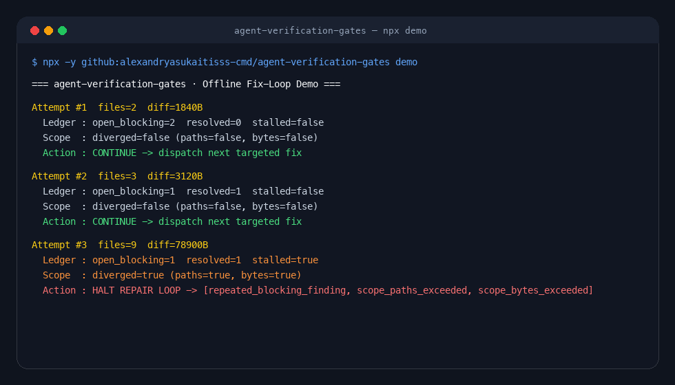

# Agent Verification Gates

[](https://github.com/alexandryasukaitisss-cmd/agent-verification-gates/actions/workflows/ci.yml)
[](https://github.com/alexandryasukaitisss-cmd/agent-verification-gates/releases)
[](package.json)
[](LICENSE)

[English](README.md) · [Релизы](https://github.com/alexandryasukaitisss-cmd/agent-verification-gates/releases) · [MIT](LICENSE)

**Библиотека проверок без зависимостей для циклов исправлений AI coding-агентов: детерминированный журнал замечаний, детектор зацикливания и регрессий, бюджеты роста диффа, контроль неизменности git-дерева и валидация манифестов UI-скриншотов.**



Когда coding-агент работает в цикле `код → тесты → ревью → правка`, он часто попадает в четыре типовые ловушки: повторяет один и тот же неработающий фикс, возвращает уже исправленный баг, раздувает правку 2 файлов до рефакторинга 40 файлов, незаметно меняет файлы внутри «read-only» проверки или отчитывается о UI без реальных скриншотов. **Agent Verification Gates** закрывает все четыре проблемы на чистом Node.js 20+ ESM без внешних пакетов.

## Быстрый запуск (без клонирования)

```sh
npx -y github:alexandryasukaitisss-cmd/agent-verification-gates demo
```

Установка в проект:

```sh
npm install github:alexandryasukaitisss-cmd/agent-verification-gates
```

## Четыре примитива верификации

1. **Журнал замечаний и анти-луп** (`mergeFindingLedger`, `evaluateFixLoopHealth`) — детерминированный SHA-256 ID для каждого замечания, подсчёт повторений и детектор повторно открытых багов (`repeated_blocking_finding`, `oscillating_regression`).
2. **Бюджеты роста объёма правок** (`evaluateScopeDivergence`) — останавливает цикл, если число изменённых файлов или размер diff вышли за допустимый порог относительно базовой попытки.
3. **Контроль неизменности git-дерева** (`gitTreeHash`, `runReadOnlyGate`) — проверяет по SHA-256 (файлы, права, симлинки, `git status`), что read-only проверка не изменила рабочую копию.
4. **Проверка UI-доказательств** (`inspectEvidenceManifest`, `inspectImageHeader`) — проверяет реальные заголовки PNG/JPEG/WebP, размеры, SHA-256, блокирует выход за пределы каталога (`..` и симлинки) и сверяет пройденные сценарии.

## Тесты

```sh
npm test
npm run demo
```

## Лицензия

MIT. См. [LICENSE](LICENSE).
